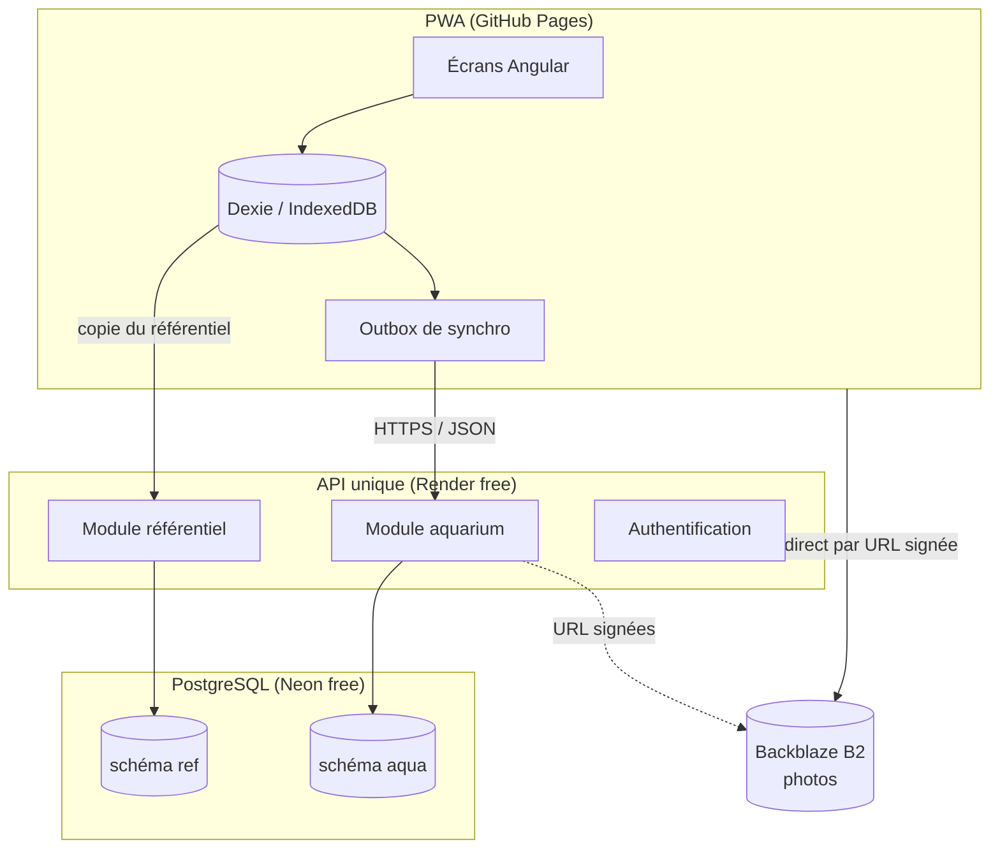
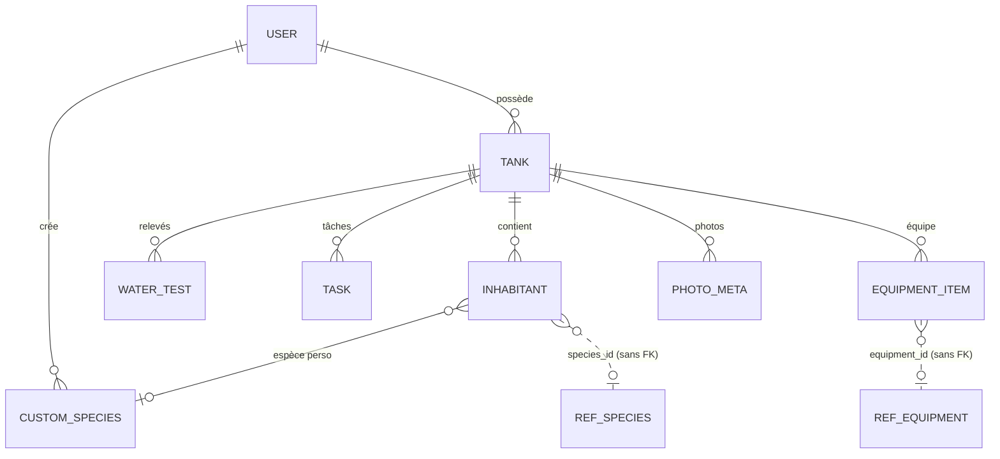
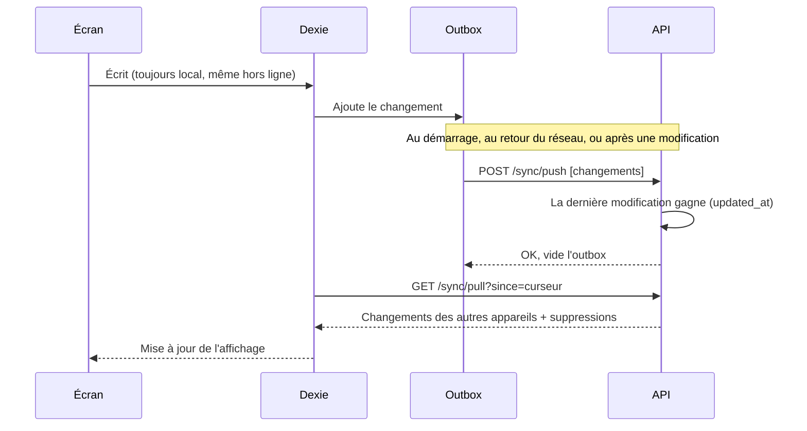
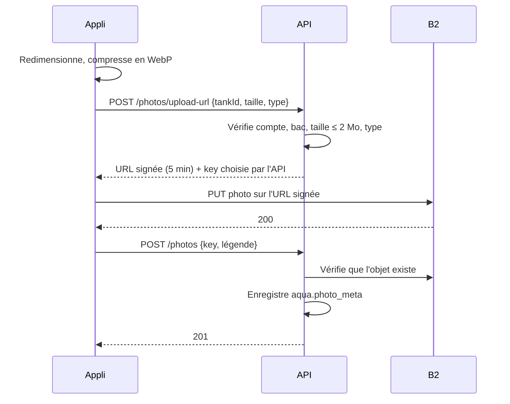

# Conception du backend

Statut : proposition, rien n'est encore implémenté.

Les décisions sont détaillées dans les [ADR](adr/README.md). Plan de mise en place : [plan-backend.md](plan-backend.md).

## 1. Point de départ

- L'appli est une PWA hors ligne : toutes les données vivent dans IndexedDB (Dexie). Elle doit **continuer à marcher sans réseau**.
- Le backend sert à deux choses :
  1. **Référentiels partagés** : espèces (le vivant), matériel, consommables. Lus par tout le monde, écrits par l'administrateur.
  2. **Données personnelles** : bacs, habitants, relevés, tâches, photos… Synchronisées entre les appareils d'un même utilisateur, avec sauvegarde côté serveur.
- Contraintes : hébergement **gratuit**, **sans carte bancaire**.

## 2. Recommandation : un seul service, deux modules

Je déconseille deux microservices pour l'instant.

| | 2 microservices | 1 service modulaire |
|---|---|---|
| Hébergement gratuit | Les heures gratuites de Render sont **partagées par compte** (750 h/mois). Deux services sollicités souvent les dépassent. | Tient dans le quota |
| Démarrage à froid | Deux réveils de ~30-60 s (Render endort un service après 15 min d'inactivité) | Un seul |
| Base de données | Une base par service, ou une base partagée, ce qui annule l'intérêt | Une base, deux schémas |
| Coût de maintenance | Deux CI, deux déploiements, appels réseau entre services | Un seul |

On découpe le code comme deux microservices (modules séparés, chacun son schéma SQL, aucune jointure entre les deux, communication par une interface interne). Si un jour il faut les séparer, on extrait un module sans réécrire.



## 3. Hébergement et base de données

**À revérifier au moment de s'inscrire** : les offres gratuites changent souvent.

| Besoin | Choix | Pourquoi | Limites connues |
|---|---|---|---|
| API | **Render** Web Service free | Déploiement depuis GitHub ou Docker, sans carte | 512 Mo RAM, mise en veille après 15 min, 750 h/mois par compte |
| Base | **Neon** Postgres free | Sans carte, ne périme pas, mise en veille automatique | ~0,5 Go de stockage, réveil en ~1 s |
| Photos | **Backblaze B2** | Compatible S3, sans carte | 10 Go de stockage, téléchargement gratuit plafonné par jour |

À éviter :
- **Postgres de Render** : la base gratuite est supprimée au bout de 30 jours.
- **Supabase** : correct, mais le projet est mis en pause après une semaine sans activité.
- **MongoDB Atlas M0** : gratuit et sans carte, mais nos données sont relationnelles (bac → habitants → espèce).

Pour les **photos** : jamais dans Postgres (0,5 Go ne suffit pas). Elles vont dans Backblaze B2, voir la section 9. Autres stockages : Cloudflare R2 et AWS S3 demandent une carte, Supabase Storage (1 Go) se met en pause, Cloudinary/ImageKit ne sont pas compatibles S3. Comme B2 parle S3, passer à R2 ou S3 plus tard ne change que la configuration.

Alternatives pour l'API si Render pose problème : Koyeb (1 service gratuit), Fly.io (carte demandée), Cloudflare Workers + D1 (gratuit, mais SQLite et un autre modèle de code).

## 4. Pile technique

- **Node 26 + TypeScript**, framework **Fastify** (léger, démarre en moins d'une seconde). NestJS est écarté : plus lourd au démarrage pour peu de gain.
- **Drizzle ORM** + migrations SQL versionnées.
- Validation avec **Zod**. On partage les types avec le front dans un dossier `shared/`, ce qui fait de ce dépôt un monorepo.
- Écartés :
  - **Spring Boot** : démarrage lent, et 512 Mo de RAM c'est juste.
  - **Rust** : démarre en ~10 ms et consomme ~10 Mo, mais le gain est inférieur à 1 s sur un réveil de 30-60 s (voir section 10). L'API fait peu de calcul ; on perdrait les types partagés avec Angular et la vitesse de développement.

## 5. Module référentiel

Données publiques, en lecture seule pour les utilisateurs.

```
ref.species      (id, nom_scientifique, noms_communs[], famille, temp_min/max, ph_min/max,
                  gh_min/max, taille_adulte, groupe_min, comportement, source, updated_at)
ref.equipment    (id, type [filtre|éclairage|chauffage|…], marque, modèle, caractéristiques jsonb, updated_at)
ref.consumable   (id, type [engrais|conditionneur|nourriture|test…], marque, nom, unité, updated_at)
```

API :
- `GET /ref/species?since=<date>` : renvoie seulement ce qui a changé depuis cette date. L'appli garde une copie dans Dexie et l'utilise hors ligne.
- `GET /ref/species/:id`, idem pour equipment et consumable.
- Écriture réservée au rôle admin. Saisie manuelle ou import CSV ; pas de remplissage automatique par IA.
- **Propositions des utilisateurs (plus tard, non cadré)** : les utilisateurs pourront proposer des fiches. Pour ne pas bloquer cette évolution, chaque fiche porte dès le départ `status` (`publiee` seulement au début) et `created_by` (nul pour les fiches de l'admin). Le circuit de proposition et de validation sera défini dans un ADR dédié.
- Réponses avec `ETag` / `Cache-Control` : le service worker les met en cache.

Les **fiches personnalisées** (espèce créée par l'utilisateur) restent dans le module aquarium. Elles ne polluent pas le référentiel commun.

## 6. Module aquarium

Données privées, toujours filtrées par `user_id`.

```
aqua.tank, aqua.inhabitant, aqua.water_test, aqua.task, aqua.equipment_item,
aqua.custom_species, aqua.photo_meta (clé B2, légende, bac, couverture, taille)
```



- Les tables reprennent les stores Dexie actuels (format de sauvegarde v1), ce qui réutilise l'import/export existant.
- Chaque ligne porte `id` (UUID généré **sur l'appareil**), `user_id`, `updated_at`, `deleted_at` (suppression logique pour la synchro).
- Les références au référentiel sont des identifiants simples (`species_id`), sans clé étrangère entre schémas.

## 7. Synchronisation (le point le plus délicat)

Modèle **local d'abord** : l'appli écrit toujours dans Dexie, puis synchronise quand le réseau est là.

1. Chaque écriture locale ajoute une entrée dans une table Dexie `outbox`.
2. `POST /sync/push` : envoie les changements en attente. Le serveur applique la règle « **la dernière modification gagne** », champ par champ ou ligne par ligne, selon `updated_at`.
3. `GET /sync/pull?since=<curseur>` : récupère ce qui a changé ailleurs, suppressions comprises.
4. La synchro se déclenche au démarrage, au retour du réseau et après chaque modification (avec un délai).

« La dernière modification gagne » suffit pour une personne avec 2 ou 3 appareils. Pas besoin de CRDT.



## 8. Comptes et sécurité

- Connexion **sans mot de passe à gérer** : lien magique par e-mail, ou « Se connecter avec Google » (OAuth/OIDC).
- Jetons JWT courts + jeton de renouvellement dans un cookie `HttpOnly`, `Secure`, `SameSite=None` (front et API sont sur deux domaines).
- CORS limité à l'URL GitHub Pages.
- Toutes les requêtes du module aquarium filtrent sur `user_id`. Tests dédiés : un utilisateur ne voit jamais les données d'un autre.
- Limite de débit sur les routes de connexion.
- Secrets (URL Neon, clé JWT) dans les variables d'environnement Render, jamais dans le dépôt.
- La CI existante s'étend au backend : npm audit, CodeQL, Dependabot, tests.
- RGPD : export (déjà fait côté appli) et suppression complète du compte (base + photos B2).

**Plusieurs utilisateurs** : l'appli est ouverte à d'autres personnes, chacune sur plusieurs appareils. En plus de ce qui précède :
- Données hébergées dans l'UE : région Europe chez Neon et chez B2 (à choisir à la création, non modifiable ensuite).
- Politique de confidentialité et mentions légales accessibles dans l'appli ; consentement explicite à la création du compte.
- Quotas par utilisateur (photos, nombre de lignes) et limite de débit par compte, pour protéger les offres gratuites.
- Tests d'isolation systématiques sur chaque route du module aquarium.
- Liste des appareils connectés et déconnexion à distance (révocation des jetons de renouvellement).

## 9. Photos

Les photos vont **directement de l'appli vers B2**, via une URL signée délivrée par l'API. C'est la pratique recommandée par les fournisseurs S3 : l'appli ne détient jamais d'identifiant, et l'API décide de tout.



- **Sur l'appareil** : redimensionnement (1600 px max) et compression WebP avant envoi, ~200-400 Ko par photo. La photo reste aussi dans IndexedDB pour l'affichage hors ligne.
- **Bucket privé** : aucune lecture publique. Lecture par `GET /photos/:id/url`, qui renvoie une URL signée courte (mise en cache côté appli).
- **Signature restrictive** : un seul objet, type et taille fixés, durée ~5 min. Le nom du fichier est choisi par l'API, jamais par l'appli.
- **CORS du bucket** limité à l'URL GitHub Pages, méthodes `PUT` et `GET` uniquement.
- **Nettoyage** : un objet envoyé mais jamais confirmé (pas de ligne `photo_meta` après 24 h) est supprimé ; la suppression d'une photo ou d'un compte supprime aussi l'objet.
- **Clé B2** (droits limités à ce bucket) uniquement dans les variables d'environnement Render.
- **Quota** : limite de stockage par utilisateur (ex. 500 Mo) pour protéger les 10 Go.
- **Hors ligne** : une photo prise sans réseau entre dans l'outbox ; elle est envoyée à la synchro suivante.

Écarté : faire transiter les photos par l'API. Sur Render gratuit (512 Mo de RAM, mise en veille, quota d'heures), c'est plus lent et plus fragile, sans gain de sécurité.

## 10. Démarrage à froid

Render endort le service gratuit après 15 min d'inactivité ; le premier appel prend alors 30 à 60 s. Avec le modèle local d'abord, **l'utilisateur ne le voit pas** : l'appli affiche ses données locales et la synchro se fait en arrière-plan.

- **Les 15 min ne sont pas réglables**, et un arrêt volontaire du processus serait vu comme un plantage puis redémarré. Inutile de toute façon : 750 h/mois couvrent un service allumé en continu (744 h sur 31 jours). C'est une raison de plus de n'avoir qu'un service.
- Ne pas ajouter de « ping » pour garder le service éveillé : cela consomme presque tout le quota, sans bénéfice pour l'utilisateur.

D'où viennent les 30-60 s (ordres de grandeur) :

| Étape | Durée | Dépend de |
|---|---|---|
| Render alloue une machine et lance le conteneur | quasi tout | Render, un peu la taille de l'image |
| Démarrage de l'API | Node + Fastify ~0,3-1 s, Rust ~10 ms | le langage |
| Réveil de Neon | ~0,5-1 s | Neon |

Le langage ne change donc presque rien. Ce qui aide vraiment :

- **Image Docker légère** : `node:26-slim` ou alpine, build en plusieurs étapes, dépendances de production seulement (`npm ci --omit=dev`).
- **JavaScript compilé à l'avance** (`tsc` ou esbuild), jamais `ts-node`/`tsx` en production.
- **Peu de dépendances**, rien de lourd chargé au démarrage.
- **Connexion à la base à la première requête**, pas au lancement.
- Route `GET /health` légère pour le contrôle de santé de Render, sans accès à la base.

Si le réveil devenait un vrai problème : changer d'hébergeur, pas de langage. Cloudflare Workers démarre en quelques millisecondes sans mise en veille, mais impose sa base SQLite (D1) au lieu de Postgres.

## 11. Étapes proposées

1. **Référentiel seul**, sans compte : API en lecture, l'appli remplace son catalogue embarqué par une copie synchronisée. Risque faible, et cela valide Render + Neon.
2. **Comptes** : connexion, sauvegarde manuelle vers le serveur (envoi du JSON de sauvegarde existant).
3. **Synchronisation automatique** (outbox, push/pull).
4. **Photos** sur Backblaze B2 (URL signées).

## 12. Questions ouvertes

- Propositions de fiches par les utilisateurs : circuit à cadrer (qui valide, modération, attribution, fiche perso promue en fiche commune ?).

Réglé :
- Langage serveur : TypeScript (ADR-0005), confirmé.
- Usage : **plusieurs utilisateurs**, chacun sur plusieurs appareils (section 8).
- Référentiel : édité par l'admin au départ, propositions des utilisateurs prévues plus tard (section 5).
