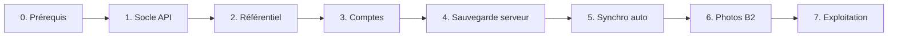

# Plan de mise en place du backend

Conception : [BACKEND.md](BACKEND.md) · Décisions : [ADR](adr/README.md)

Principe : chaque étape est livrable seule, l'appli continue de fonctionner hors ligne à chaque étape, et le backend reste optionnel jusqu'à l'étape 4.

## 0. Prérequis (côté toi)

- [x] Valider les ADR (statut « Acceptée ») et répondre aux questions ouvertes de BACKEND.md.
- [ ] Créer les comptes gratuits : Render, Neon, Backblaze B2 (sans carte), **en région Europe** (non modifiable ensuite).
- [ ] Vérifier les quotas gratuits du moment.
- [ ] Activer sur GitHub : Dependency graph, Secret scanning, Push protection.

## 1. Socle de l'API

- [ ] Monorepo : dossiers `api/` et `shared/` (types et schémas Zod communs), workspaces npm.
- [ ] Fastify + TypeScript, config par variables d'environnement validées au démarrage.
- [ ] Route `GET /health` (sans base).
- [ ] Drizzle + Neon : connexion à la première requête, migrations versionnées, schémas `ref` et `aqua`.
- [ ] Dockerfile multi-étapes `node:26-slim`, JS compilé, dépendances de production seulement.
- [ ] CI : lint, tests (Vitest + base Postgres de test), npm audit, CodeQL étendu à `api/`, règle d'imports entre modules (ADR-0001).
- [ ] Déploiement Render depuis `main`, après la CI.
- [ ] CORS limité à l'URL GitHub Pages, en-têtes de sécurité, limite de débit.

**Terminé quand** : `/health` répond en production ; mesure du temps de réveil notée.

## 2. Module référentiel (sans compte)

- [ ] Tables `ref.species`, `ref.equipment`, `ref.consumable`, avec `status` et `created_by` dès le départ (propositions futures).
- [ ] Script d'import depuis le catalogue embarqué actuel (saisie manuelle / CSV, pas d'IA).
- [ ] `GET /ref/<type>?since=` et `GET /ref/<type>/:id`, avec `ETag` et `Cache-Control`.
- [ ] Appli : copie locale dans Dexie, mise à jour au démarrage ; repli sur le catalogue embarqué si l'API ne répond pas.
- [ ] Écriture réservée à l'admin (jeton simple en attendant l'étape 3).
- [ ] Tests unitaires + E2E (API simulée et API réelle).

**Terminé quand** : une fiche ajoutée côté serveur apparaît dans l'appli, y compris après passage hors ligne.

## 3. Comptes

- [ ] Choisir le service d'envoi d'e-mails gratuit (lien magique) et/ou configurer Google OIDC.
- [ ] Table des utilisateurs, jetons d'accès courts, jeton de renouvellement en cookie révocable.
- [ ] Tester le cookie sur Safari / iOS ; sinon, sous-domaine commun ou repli sur jeton (ADR-0007).
- [ ] Écran de connexion dans l'appli ; l'appli reste utilisable sans compte.
- [ ] Rôle admin pour le référentiel.
- [ ] Suppression complète du compte (RGPD), photos B2 comprises.
- [ ] Politique de confidentialité, mentions légales, consentement à l'inscription.
- [ ] Liste des appareils connectés, déconnexion à distance.
- [ ] Quotas et limite de débit par compte.

**Terminé quand** : connexion et déconnexion fonctionnent sur ordinateur et mobile, Safari compris.

## 4. Sauvegarde vers le serveur

- [ ] Tables `aqua.*` reprenant le format de sauvegarde v1 (UUID, `updated_at`, `deleted_at`).
- [ ] `POST /backup` et `GET /backup` en réutilisant l'import/export existant.
- [ ] Tests d'isolation : un utilisateur ne lit ni n'écrit jamais les données d'un autre.

**Terminé quand** : sauvegarde sur un appareil, restauration sur un autre.

## 5. Synchronisation automatique

- [ ] Migration Dexie : table `outbox`, champs `updated_at` / `deleted_at`, UUID partout.
- [ ] `POST /sync/push` et `GET /sync/pull?since=`, règle « la dernière modification gagne ».
- [ ] Déclenchement : démarrage, retour du réseau, après modification (avec délai).
- [ ] Indicateur discret dans l'appli : synchronisé / en attente / erreur.
- [ ] Tests : deux appareils simulés, conflits, suppression, hors ligne prolongé, horloge décalée.

**Terminé quand** : une modification faite hors ligne sur le téléphone apparaît sur l'ordinateur après retour du réseau.

## 6. Photos sur Backblaze B2

- [ ] Bucket privé, clé limitée au bucket, CORS limité à GitHub Pages.
- [ ] Compression dans l'appli (WebP, 1600 px).
- [ ] `POST /photos/upload-url`, `POST /photos`, `GET /photos/:id/url`, suppression.
- [ ] Photos prises hors ligne envoyées via l'outbox.
- [ ] Nettoyage des objets non confirmés (24 h), quota par utilisateur.

**Terminé quand** : une photo prise sur le téléphone s'affiche sur l'ordinateur, et sa suppression supprime l'objet B2.

## 7. Exploitation

- [ ] Journaux structurés sans données personnelles.
- [ ] Sauvegarde régulière de la base (dump vers B2).
- [ ] Alerte simple si `/health` échoue (service de surveillance gratuit).
- [ ] Documentation : variables d'environnement, déploiement, restauration.

## Plus tard (non cadré)

- [ ] Propositions de fiches par les utilisateurs : cadrer le besoin, puis ADR (validation, modération, attribution).

## Risques suivis

| Risque | Parade |
|---|---|
| Une offre gratuite change ou disparaît | Docker, SQL standard et API S3 permettent de migrer |
| Cookie bloqué sur Safari | Test dès l'étape 3, solutions prévues dans ADR-0007 |
| Perte de données lors d'un conflit de synchro | Règle documentée, sauvegarde JSON toujours disponible |
| Quota B2 ou Neon atteint | Quota par utilisateur, compression, surveillance |
