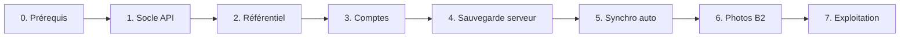

# Plan de mise en place du backend

Conception : [BACKEND.md](BACKEND.md) · Décisions : [ADR](adr/README.md) · Conformité et sécurité : [plan-transverse.md](plan-transverse.md) · Qualité : [qualite-backend.md](qualite-backend.md)

**Avancement** : étapes 1 à 5 réalisées et déployées (catalogue en ligne, comptes, synchronisation). Restent : test Safari/iOS (étape 3), photos (étape 6), exploitation (étape 7).

Principe : chaque étape est livrable seule, l'appli continue de fonctionner hors ligne à chaque étape, et le backend reste optionnel jusqu'à l'étape 4.

## 0. Prérequis (côté toi)

- [x] Valider les ADR (statut « Acceptée ») et répondre aux questions ouvertes de BACKEND.md.
- [ ] Créer les comptes gratuits : Render, Neon, Backblaze B2 (sans carte), **en région Europe** (non modifiable ensuite).
- [ ] Vérifier les quotas gratuits du moment.
- [ ] Activer sur GitHub : Dependency graph, Secret scanning, Push protection.

## 1. Socle de l'API

- [x] Monorepo : dossiers `api/` et `shared/` (types et schémas Zod communs), workspaces npm.
- [x] Fastify + TypeScript, config par variables d'environnement validées au démarrage.
- [x] Route `GET /health` (sans base).
- [x] Drizzle + PostgreSQL : connexion à la première requête, migrations versionnées, schémas `ref` et `aqua` (testé sur PostgreSQL 17 local ; reste à essayer sur Neon).
- [x] Dockerfile multi-étapes `node:26-slim`, JS compilé, dépendances de production seulement.
- [x] CI conforme aux [attendus qualité](qualite-backend.md) : lint 0 avertissement, couverture 80 %, mutation, tests d'intégration et E2E de l'API, audits de sécurité.
  - Fait : audit, build, lint, format, knip, tests unitaires + intégration (PostgreSQL réel) à 80 %, mutation Stryker (93 %), tests E2E sur le serveur compilé, CodeQL, gitleaks (historique complet), Trivy sur l'image, taille d'image (90 Mo compressés).
  - Reste : génération OpenAPI, tests de fumée en production (attend le déploiement).
- [ ] Déploiement Render (attend les comptes) depuis `main`, après la CI.
- [x] CORS limité à l'URL GitHub Pages, en-têtes de sécurité, limite de débit.

**Terminé quand** : `/health` répond en production ; mesure du temps de réveil notée.

## 2. Module référentiel (sans compte)

- [x] Tables `ref.species`, `ref.equipment`, `ref.consumable`, avec `status` et `created_by` dès le départ (propositions futures), et `deleted_at` pour propager les retraits.
- [x] Script d'import depuis le catalogue embarqué actuel : `npm run catalog:export` (une fois, vers `api/data/species.json`) puis `npm run import:ref -w api` (idempotent : une fiche inchangée n'est pas réécrite). Pas d'IA.
- [x] `GET /ref/<type>?since=` et `GET /ref/<type>/:id`, avec `ETag` et `Cache-Control`.
- [x] Appli : copie locale dans Dexie (table `species`, point de reprise dans `refMeta`), mise à jour au démarrage ; repli sur le catalogue embarqué si l'API ne répond pas.
- [x] **Interrupteur dans Réglages › Catalogue en ligne (bêta), désactivé par défaut** : désactivé, l'appli fonctionne exactement comme avant. Réglage propre à l'appareil, indisponible tant que l'adresse de l'API n'est pas renseignée (`src/app/core/api-config.ts`).
- [x] Écriture réservée à l'admin (jeton `ADMIN_TOKEN` en attendant l'étape 3 ; sans jeton configuré, l'écriture est fermée).
- [x] Tests unitaires, intégration (PostgreSQL réel), E2E du serveur compilé, E2E Playwright de l'état par défaut.
- [x] Déployé le 2026-10-28 : API sur Render (`https://mes-aquariums-api.onrender.com`), base sur Neon (Francfort), 34 espèces importées, adresse renseignée dans `api-config.ts` et dans la CSP de l'appli. Le cache du service worker n'est pas nécessaire (copie locale dans Dexie).
- [ ] Reste : définir `ADMIN_TOKEN` sur Render si l'écriture du référentiel est voulue, test Playwright avec l'API réelle.
- Limites assumées : seules les espèces existent dans l'appli (pas encore de catalogue de matériel ni de consommables) ; les tables `equipment` et `consumable` et leurs routes sont prêtes mais vides, sans synchronisation côté appli.

**Terminé quand** : une fiche ajoutée côté serveur apparaît dans l'appli, y compris après passage hors ligne.

## 3. Comptes

Cadrage : [ADR-0007](adr/0007-authentification-sans-mot-de-passe.md) (connexion), [ADR-0011](adr/0011-cgu-confidentialite-consentement.md) (CGU et consentement), [ADR-0014](adr/0014-securite-applicative.md) (sécurité), [plan-transverse.md §3](plan-transverse.md). Le détail est découpé en trois lots : les deux premiers se font **sans aucun compte cloud** (PostgreSQL local, e-mails capturés par un faux serveur), le troisième demande les comptes.

### 3a. Socle serveur des comptes (sans compte cloud)

- [x] Schéma `auth` (migration `0001_comptes`) : `users` (id UUID, e-mail normalisé unique, rôle `user`/`admin`, `created_at`, `last_seen_at`), `sessions` (jeton de renouvellement **haché**, appareil, dates, révocation), `login_tokens` (lien magique : haché, usage unique, expiration 15 min), `user_consents` (document, version, date). Migration Drizzle.
- [x] Lien magique : `POST /auth/magic-link` (réponse identique que le compte existe ou non, limite de débit par IP et par e-mail), `POST /auth/verify`.
- [x] Jeton d'accès JWT court (15 min) ; jeton de renouvellement en cookie `HttpOnly`, `Secure`, `SameSite=None`, **rotation à chaque usage** et détection de réutilisation (révoque la session).
- [x] `POST /auth/refresh`, `POST /auth/logout`, `GET /me`, `GET /me/sessions`, `DELETE /me/sessions/:id` (liste des appareils, déconnexion à distance).
- [x] Envoi d'e-mails derrière une interface `Mailer` : implémentation « console/capture » pour les tests et le développement, implémentation SMTP ou API du service choisi ensuite.
- [x] Hook d'authentification Fastify (`requireUser`, `requireAdmin`) et couche commune de filtrage par `user_id` ; **test d'isolation obligatoire sur chaque route** protégée.
- [x] Rôle admin : l'écriture du référentiel passe de `ADMIN_TOKEN` à `requireAdmin` (le jeton reste un secours désactivable).
- [x] Consentement à l'inscription : refus sans acceptation des CGU/confidentialité (versions courantes) et déclaration « au moins 15 ans » ; nouvelle acceptation exigée quand la version change.
- [x] Quotas et limite de débit par compte.
- [ ] Tests : unitaires, intégration (PostgreSQL réel), E2E du serveur compilé (parcours complet connexion → refresh → déconnexion), mutation ≥ seuils actuels.

Décisions prises en route : cookie nommé `__Host-refresh` (refusé par le navigateur sans `Secure`, `Path=/` ou avec un `Domain`) ; les routes à cookie (`/auth/refresh`, `/auth/logout`) n'acceptent que l'en-tête `Origin` de l'appli (protection contre la falsification de requête, le cookie étant `SameSite=None`) ; chaque requête authentifiée vérifie que la session n'est ni révoquée ni expirée (la déconnexion à distance est immédiate) ; le rôle administrateur vient de `ADMIN_EMAILS`, appliqué à chaque connexion ; le consentement est demandé à la vérification du lien (réponse `409 consent_required`, lien non consommé), ce qui évite de révéler si une adresse a un compte.

### 3b. Appli (sans compte cloud)

- [x] Service d'authentification Angular (jeton d'accès en mémoire seulement, jamais en `localStorage`), requêtes authentifiées avec renouvellement automatique (verrou entre onglets), reprise silencieuse au démarrage.
- [x] Écran de connexion (saisie de l'e-mail, message « consultez vos e-mails », page de retour du lien) ; **l'appli reste entièrement utilisable sans compte** et le comportement par défaut ne change pas.
- [x] Réglages › Compte : état, appareils connectés, déconnexion.
- [x] Pages Confidentialité, Mentions légales, CGU accessibles hors ligne et sans compte (textes écrits en tant que particulier, conservation des comptes inactifs : 12 mois).
- [x] Interrupteur de fonctionnalité : `ACCOUNTS_OPEN` dans `api-config.ts`, **ouvert le 2026-10-28** à la demande de l'éditeur ; sans service d'e-mails, la connexion répond « envoi non disponible » (voir 3c).
- [x] Tests unitaires (service, connexion, textes légaux, réglages) et Playwright (section Compte, écran de connexion, textes légaux). La connexion complète sera testée en 3c contre l'API réelle.
- [x] Adresse de contact renseignée (`contactEmail`).
- [ ] Reste : faire relire les textes (`src/app/pages/legal/legal.ts`), vérifier les adresses des hébergeurs et les garanties de transfert.

### 3c. Avec les comptes cloud

- [ ] Choisir le service d'envoi d'e-mails gratuit (quota, région UE, DPA) et/ou configurer Google OIDC.
- [ ] Déploiement Render + Neon (voir étape 2) puis `JWT_SECRET`, clé d'envoi d'e-mails, domaine expéditeur (SPF/DKIM).
- [ ] **Tester le cookie sur Safari / iOS** ; sinon sous-domaine commun ou repli sur jeton (ADR-0007).
- [x] Suppression complète du compte en libre-service (`DELETE /me`, bouton dans Réglages › Compte, confirmation) : compte, appareils, consentements, liens en attente. Les photos B2 et les données d'aquarium seront ajoutées à `deleteAccount` aux étapes 4 et 6 ; l'offre d'effacer aussi les données locales viendra avec la synchronisation (étape 4).
- [x] Purge des comptes inactifs : avertissement par e-mail après 12 mois sans connexion, suppression 30 jours plus tard, jamais sans avertissement envoyé ; se reconnecter annule l'avertissement. Lancée une minute après le démarrage du service puis chaque jour, et chaque semaine par la tâche GitHub `purge.yml` (`POST /admin/purge-inactive`, qui réveille aussi le service).
- [ ] Test Playwright de bout en bout contre l'API réelle.

**Terminé quand** : connexion et déconnexion fonctionnent sur ordinateur et mobile, Safari compris.

**Points à trancher avant de commencer (3a)** :

1. Google OIDC en plus du lien magique, ou lien magique seul pour la première version ? (recommandé : lien magique seul, Google ensuite)
2. Jeton d'accès : JWT signé HS256 avec secret unique (simple) ou EdDSA (clé publique, plus lourd) ? (recommandé : HS256 via `jose`)
3. Service d'e-mails : à choisir au lot 3c, sans effet sur 3a/3b grâce à l'interface `Mailer`.

## 4. Sauvegarde vers le serveur — réalisée par la synchronisation (étape 5)

- [x] Table `aqua.records` : une ligne par enregistrement de l'appli (table, id, données JSON, date de modification, suppression), clé `(user_id, table, id)`, supprimée avec le compte (cascade). Plutôt qu'une table par type : le format de l'appli peut évoluer sans migration serveur.
- [x] Plus besoin de `POST /backup` / `GET /backup` : la synchronisation envoie et récupère tout. L'export ZIP reste disponible dans Réglages pour une sauvegarde hors ligne.
- [x] Tests d'isolation : un compte ne lit ni n'écrase jamais les données d'un autre (même identifiant de ligne compris).

**Terminé quand** : sauvegarde sur un appareil, restauration sur un autre. ✔ (connexion sur le second appareil = récupération complète)

## 5. Synchronisation automatique

- [x] Dexie v10 : table `outbox` remplie automatiquement par un middleware sur chaque écriture locale (ajout, modification, suppression, y compris en masse), dans la même transaction. Les identifiants étaient déjà des UUID et chaque ligne a un `updatedAt`.
- [x] `POST /sync/push` (100 lignes max, 64 Ko par ligne) et `GET /sync/pull?after=` (curseur serveur croissant, pages de 500) ; règle « la dernière modification gagne », date d'une horloge en avance ramenée à l'heure du serveur ; quota de 50 000 lignes par compte.
- [x] Déclenchement : connexion et démarrage, retour du réseau, retour au premier plan, 3 s après une modification, toutes les 5 minutes ; un seul échange à la fois (verrou entre onglets).
- [x] Indicateur dans Réglages › Compte : à jour / en cours / hors ligne / quota / erreur, modifications en attente, bouton « Synchroniser maintenant ».
- [x] Premier passage d'un compte sur un appareil : tout ce que l'appareil contient part au serveur (fusion avec les autres appareils). Un autre compte sur le même appareil repart d'un envoi complet.
- [x] Tests : deux appareils simulés, conflits, suppression, hors ligne, modification pendant l'envoi, horloge en avance (API), isolation, E2E sur le serveur compilé.
- [x] Corrigé en route : une déconnexion pendant un renouvellement de session reconnectait l'appareil.
- Limites : les photos ne voyagent pas encore (étape 6) ; les fiches d'espèces intégrées ou du catalogue en ligne non plus (seules celles créées par l'utilisateur) ; les suppressions restent en base (purge à 90 jours à faire, voir plan-transverse).
- Politique de confidentialité passée en version 2 (données synchronisées) : nouvelle acceptation à la prochaine connexion par lien.

**Terminé quand** : une modification faite hors ligne sur le téléphone apparaît sur l'ordinateur après retour du réseau. ✔ (testé avec deux appareils simulés ; à vérifier sur tes vrais appareils)

## 6. Photos sur Backblaze B2

- [ ] Bucket privé, clé limitée au bucket, CORS limité à GitHub Pages.
- [ ] Compression dans l'appli (WebP, 1600 px).
- [ ] `POST /photos/upload-url`, `POST /photos`, `GET /photos/:id/url`, suppression.
- [ ] Photos prises hors ligne envoyées via l'outbox.
- [ ] Nettoyage des objets non confirmés (24 h), quota par utilisateur.

**Terminé quand** : une photo prise sur le téléphone s'affiche sur l'ordinateur, et sa suppression supprime l'objet B2.

## 7. Exploitation

- [ ] Journaux structurés sans données personnelles.
- [ ] Sauvegarde régulière de la base (dump vers B2).
- [ ] Alerte simple si `/health` échoue (service de surveillance gratuit).
- [ ] Documentation : variables d'environnement, déploiement, restauration.

## Actions de sécurité à faire plus tard (de ton côté)

- [ ] Changer le mot de passe de la base Neon (Roles › `neondb_owner` › Reset password) puis mettre la nouvelle `DATABASE_URL` dans Render : l'ancien est apparu dans une conversation.
- [ ] Remplacer `ADMIN_TOKEN` et `JWT_SECRET` (`openssl rand -base64 36`) dans Render : ils sont aussi apparus dans une conversation. Changer `JWT_SECRET` déconnecte tout le monde.
- [ ] Ajouter le secret `ADMIN_TOKEN` (même valeur que dans Render) dans GitHub › Settings › Secrets and variables › Actions, pour que la tâche hebdomadaire `purge.yml` puisse lancer la purge. Sans lui, elle ne fait rien (le service purge déjà chaque jour tant qu'il tourne).
- [ ] Activer sur GitHub : Dependency graph, Secret scanning, Push protection.
- [ ] Vérifier la clé d'API Brevo : filtrage par IP désactivé, aucune copie hors de Render.

## Plus tard (non cadré)

- [ ] Propositions de fiches par les utilisateurs : cadrer le besoin, puis ADR (validation, modération, attribution).

## Risques suivis

| Risque                                        | Parade                                                |
| --------------------------------------------- | ----------------------------------------------------- |
| Une offre gratuite change ou disparaît        | Docker, SQL standard et API S3 permettent de migrer   |
| Cookie bloqué sur Safari                      | Test dès l'étape 3, solutions prévues dans ADR-0007   |
| Perte de données lors d'un conflit de synchro | Règle documentée, sauvegarde JSON toujours disponible |
| Quota B2 ou Neon atteint                      | Quota par utilisateur, compression, surveillance      |
