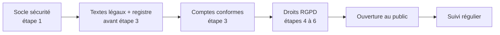

# Plan transverse : conformité européenne et sécurité

Décisions : [ADR 0008 à 0014](adr/README.md) · Plan technique : [plan-backend.md](plan-backend.md)

Ces chantiers ne sont pas une étape à part : chaque bloc indique l'étape du plan backend **avant laquelle** il doit être terminé. Rien n'est ouvert au public tant que les blocs marqués « avant ouverture » ne sont pas faits.

Ce plan ne remplace pas un conseil juridique.

## 1. Socle de sécurité — avec l'étape 1 (ADR-0014, 0012)

- [ ] HTTPS, HSTS, en-têtes de sécurité (CSP `default-src 'self'`, `frame-ancestors 'none'`, etc.) sur l'API et sur l'appli (balise meta CSP pour GitHub Pages).
- [ ] Validation Zod de toutes les entrées, taille de corps limitée.
- [ ] Limite de débit par IP et par compte.
- [ ] Secrets dans Render uniquement, rôle Postgres et clé B2 à droits minimaux.
- [ ] Journaux sans données personnelles, conservés 30 jours.
- [ ] CI étendue à `api/` : npm audit, CodeQL, Dependabot, actions épinglées.
- [ ] Vérification automatique : aucune ressource chargée depuis un domaine tiers.

## 2. Registre, sous-traitants, textes — avant l'étape 3 (ADR-0008, 0011, 0012)

- [ ] Créer les services en **région Europe** : Neon, B2, Render (Frankfurt).
- [ ] Accepter et archiver le DPA de chaque sous-traitant (Render, Neon, Backblaze, service d'e-mail, Google) ; noter les garanties de transfert hors UE.
- [ ] `docs/rgpd/registre.md` : traitements, finalités, données, durées, sous-traitants.
- [ ] `docs/legal/` (versionnés, à partir des modèles CNIL) :
  - [ ] Mentions légales, modèle **particulier non professionnel** (hébergeur + contact, identité confiée à l'hébergeur).
  - [ ] Politique de confidentialité (données, finalités, durées, sous-traitants, traceurs, droits, contact, droit de réclamation à la CNIL).
  - [ ] Conditions d'utilisation (service gratuit sans garantie, conduite, contenus et licence des fiches proposées, suspension, droit applicable).
- [ ] Adresse e-mail de contact dédiée (droits RGPD et signalements).
- [ ] Pages accessibles dans l'appli, sans compte et hors ligne.

## 3. Comptes conformes — avec l'étape 3 (ADR-0007, 0011, 0014)

- [ ] Inscription : case non pré-cochée CGU + confidentialité, déclaration « au moins 15 ans ».
- [ ] Table `user_consents` (document, version, date) ; nouvelle acceptation demandée quand les CGU changent.
- [ ] Jetons de renouvellement hachés, rotation, liste des appareils, déconnexion à distance.
- [ ] Couche commune de filtrage par `user_id` + tests d'isolation sur chaque route.

## 4. Droits des utilisateurs — avec les étapes 4 à 6 (ADR-0009, 0010)

- [ ] **Export** `GET /me/export` : ZIP en flux (JSON v1 + photos d'origine + `compte.json`), 1 par heure ; schéma JSON publié.
- [ ] **Suppression du compte** en libre-service, avec confirmation : base, objets B2, jetons ; fiches publiées anonymisées ; proposition d'effacer aussi les données locales.
- [ ] Test : après suppression, plus aucune ligne ni objet B2 pour l'utilisateur.
- [ ] Retrait des métadonnées EXIF (GPS compris) avant envoi des photos (étape 6).
- [ ] Tâches planifiées de purge :
  - [x] lignes supprimées après 90 jours (`aqua.records`) ;
  - [ ] objets B2 non confirmés après 24 h ;
  - [x] **comptes inactifs : avertissement après 12 mois, suppression 30 jours plus tard** ;
  - [ ] sauvegardes de la base au-delà de 30 jours.

## 5. Avant l'ouverture au public

- [ ] Procédure de violation de données `docs/rgpd/violation.md` (évaluer, CNIL sous 72 h, informer les utilisateurs, registre des violations).
- [ ] Procédure de réponse aux demandes RGPD reçues par e-mail (sous un mois).
- [ ] Relecture de la liste OWASP ASVS niveau 1.
- [ ] Relecture des textes légaux, si possible par une personne compétente.
- [ ] Vérifier que l'appli n'utilise que des traceurs strictement nécessaires (pas de bandeau).

## 6. Avec les propositions de fiches (plus tard) (ADR-0013)

- [ ] Publication après validation par l'admin.
- [ ] Bouton « Signaler », table `reports`, écran d'admin, information de l'auteur et contestation.
- [ ] Journal des signalements conservé un an.
- [ ] Licence des fiches proposées précisée dans les CGU.

## 7. Suivi régulier

- [ ] Chaque nouvelle donnée ou nouveau fournisseur : mise à jour du registre et de la politique de confidentialité.
- [ ] Une fois par an : relire le registre, les durées de conservation, les DPA, les ADR transverses.
- [ ] Vérifier qu'aucun service gratuit n'a changé ses conditions (région, DPA, quotas).
