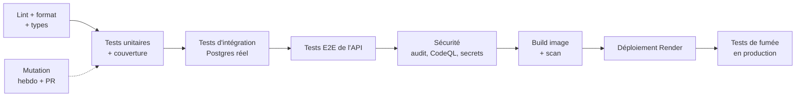

# Attendus qualité du backend

Plans : [plan-backend.md](plan-backend.md) · [plan-transverse.md](plan-transverse.md) · Décisions : [ADR](adr/README.md)

Règle générale : **tout est vérifié automatiquement par la CI, et un seul critère non respecté bloque la fusion et le déploiement**. Aucun seuil n'est abaissé pour faire passer une PR ; une exception se justifie dans la PR et dans le code, au cas par cas.

## 1. Lint, format, types : zéro avertissement

| Attendu | Outil / règle |
|---|---|
| Typage strict | `tsc --noEmit`, `strict: true`, `noUncheckedIndexedAccess`, `exactOptionalPropertyTypes`, `noImplicitOverride` |
| Lint | ESLint + `typescript-eslint` en **`strict-type-checked`** et **`stylistic-type-checked`** |
| Règles en plus | promesses non attendues interdites (`no-floating-promises`), `no-explicit-any`, imports triés, pas de `console` (logger structuré), `eslint-plugin-security` |
| Frontières de modules | `ref` et `aqua` ne s'importent pas entre eux (ADR-0001), via `eslint-plugin-boundaries` ou `no-restricted-imports` |
| Format | Prettier, vérifié en CI (`--check`) |
| Seuil | **0 erreur, 0 avertissement** (`--max-warnings 0`) |
| Exceptions | `eslint-disable` interdit sans commentaire de justification sur la même ligne (`eslint-comments/require-description`) |
| Code mort | `knip` : aucun export, fichier ou dépendance inutilisés |

L'appli Angular n'a pas encore de linter : on l'ajoute aussi avec les mêmes règles (voir section 9).

## 2. Tests unitaires et couverture

- **Vitest**, comme l'appli.
- Couverture mesurée sur `api/` et `shared/` (V8), **seuils bloquants** :

| Indicateur | Minimum |
|---|---|
| Lignes | 80 % |
| Instructions | 80 % |
| Fonctions | 80 % |
| Branches | 80 % |

- La couverture d'une PR ne baisse pas par rapport à `main`.
- Tout correctif de bug commence par un test qui reproduit le bug.
- Tests déterministes : horloge et UUID injectables, aucune dépendance au réseau ni à l'heure réelle. Un test instable est corrigé ou mis en quarantaine dans la journée, jamais relancé jusqu'à ce qu'il passe.

## 3. Tests de mutation

- **Stryker** avec le lanceur Vitest, comme l'appli.
- Seuils : **high 90 · low 75 · break 75** (identiques au front).
- Sur PR : mutation **incrémentale** sur les fichiers modifiés. Chaque semaine : exécution complète.
- Priorité aux mutants survivants dans : autorisation (`user_id`), synchro (règle de conflit), purge RGPD, validation des entrées.

## 4. Tests d'intégration (base réelle)

- PostgreSQL **réel** en CI (conteneur `postgres` de la même version majeure que Neon), jamais de base simulée pour le SQL.
- Les migrations Drizzle sont jouées depuis zéro à chaque exécution, puis vérifiées : montée, et montée depuis la version précédente avec données.
- Chaque test dans une transaction annulée, ou une base dédiée, pour rester isolé.
- B2 simulé par **MinIO** (compatible S3) pour les URL signées.

## 5. Tests E2E de l'API

Ils lancent l'API complète (image Docker de production) contre Postgres et MinIO, et l'appellent en HTTP comme le fera l'appli.

- **Parcours** : référentiel (`?since=`, ETag/304), connexion (lien magique avec boîte e-mail de test), sauvegarde/restauration, synchro push/pull avec deux appareils simulés et conflit, photo (URL signée → envoi → confirmation → lecture → suppression), export RGPD, suppression de compte.
- **Sécurité** : pour **chaque route** du module aquarium, un utilisateur B reçoit 404/403 sur les données de A ; requêtes sans jeton, jeton expiré, jeton révoqué ; limites de débit atteintes ; corps trop gros ; en-têtes de sécurité présents.
- **Contrat** : la spécification OpenAPI est générée depuis les schémas Zod partagés et publiée ; chaque réponse est validée contre elle. Un test de propriétés (Schemathesis ou équivalent) bombarde l'API avec des entrées générées : aucune erreur 500 tolérée.
- **Contrat avec l'appli** : l'appli utilise les mêmes schémas `shared/` ; un changement incompatible casse la compilation des deux côtés.
- **E2E de bout en bout** : les tests Playwright existants gagnent un projet qui tourne contre l'API réelle (connexion, synchro entre deux contextes de navigateur, photo).
- **Fumée en production** : après chaque déploiement, `/health`, une lecture du référentiel et une connexion de compte de test ; échec → alerte et retour à la version précédente.

## 6. Sécurité

| Contrôle | Seuil bloquant |
|---|---|
| `npm audit --omit=dev` | aucune vulnérabilité **high** ou **critical** |
| `npm audit` (dev compris) | aucune **critical** |
| CodeQL (`javascript-typescript`, `actions`) | aucune alerte ouverte de sévérité haute ou plus |
| Revue des dépendances (PR) | pas de vulnérabilité high, licences GPL/AGPL refusées |
| Recherche de secrets | gitleaks en CI + push protection GitHub : 0 secret |
| Image Docker | Trivy : aucune vulnérabilité **high/critical** corrigeable |
| Dependabot | PR traitées sous 7 jours (sécurité : 48 h) |
| Actions GitHub | épinglées par SHA, permissions minimales par job |
| En-têtes et isolation | couverts par les tests E2E (section 5) |

Une vulnérabilité sans correctif disponible peut être acceptée temporairement, avec justification, date d'expiration et ticket de suivi.

## 7. Performance et robustesse

- Démarrage de l'API (hors réveil Render) : **< 1 s**, mesuré en CI.
- Taille de l'image Docker : **< 200 Mo compressés** (taille de téléchargement). Mesuré à la première construction : 401 Mo décompressés, dont 144 Mo pour le binaire Node ; les couches de l'appli ne font que 44 Mo.
- Réponse p95 sur les routes de lecture, base réveillée : **< 300 ms** (mesure de fumée).
- Mémoire en charge normale : **< 256 Mo** (moitié de l'offre Render).
- Export et photos en flux : jamais de fichier entier en mémoire.

## 8. Pratiques de développement

- Toute modification passe par une PR, même seul : la CI complète tourne avant fusion. Pas de push direct sur `main` pour `api/` une fois l'étape 1 livrée.
- Commits clairs, en français.
- Une décision structurante = un ADR.
- Documentation à jour dans la même PR (BACKEND.md, OpenAPI, plans).
- Journaux structurés (pino), sans données personnelles (ADR-0014).

## 9. Mise en place

- [ ] Étape 1 du plan backend : ESLint strict, Prettier, knip, tsc strict, Vitest + seuils, Stryker, Postgres + MinIO en CI, gitleaks, Trivy, tests de fumée.
- [ ] Étape 1 : squelette des tests E2E de l'API et génération OpenAPI.
- [ ] Chaque étape suivante : ses tests E2E de l'API et d'isolation avant d'être déclarée terminée.
- [x] Appli Angular : ESLint (`angular-eslint` + typescript-eslint strict avec types + sécurité), 0 avertissement, Prettier et knip vérifiés en CI (fait avant le backend).
  - Désactivations assumées, à reprendre dans l'API : `security/detect-object-injection` (faux positifs en masse ; couvert par le typage et CodeQL), règles `no-unsafe-*` et `require-await` dans les tests seulement (simulacres et `JSON.parse`).
  - Les assertions non nulles `!` sont remplacées par `must()` (échec explicite si la valeur manque).
  - Prettier est configuré sans formatage des modèles Angular en ligne (il y ajoutait des espaces visibles) ; `catalog.ts` (lu par regex par `build-ai`) et `app.html` sont ignorés.
  - `noUncheckedIndexedAccess` activé dans l'appli (désactivé dans les tests unitaires : un indice absent y fait déjà échouer le test). À activer dans l'API dès le départ.
  - Gestionnaire d'erreurs global : toute erreur non gérée (dont une promesse `void` qui échoue) est tracée en console et affichée dans un bandeau d'alerte. L'API devra renvoyer des erreurs exploitables par ce bandeau.
